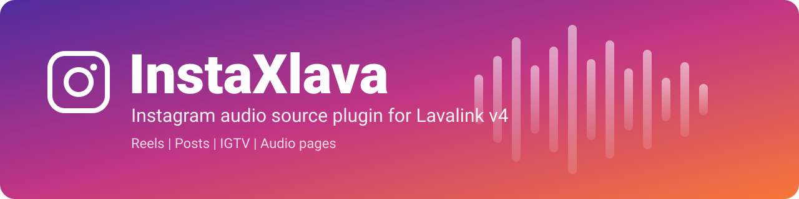

<p align="center">
  
</p>

<h1 align="center">InstaXlava</h1>

<p align="center">
  Play Instagram reels, posts, IGTV and audio pages through Lavalink v4.
</p>

<p align="center">
  
  
  
  
</p>

---

##  What it is for

InstaXlava is a Lavalink plugin that adds an `instagram` audio source. Once it is installed, any Discord music bot that
talks to your Lavalink server can load an Instagram link the same way it loads any other track, and play the audio in a
voice channel. No changes are needed in the bot: it just sends the Instagram URL to Lavalink.

Use it when you want your bot to:

- play the sound of an Instagram reel or post that a member pastes into chat
- play an Instagram audio page (`/reels/audio/ID`), including songs that have no direct stream, by finding the same song on another source
- keep playing smoothly even though Instagram stream links expire after a short time

##  Features

| | Feature |
|---|---|
|  | Many link formats: posts, reels, IGTV, username links, share links, mirror hosts and raw media IDs |
|  | Stable playback: expiring stream links are refreshed, failed starts are retried, a track that drops mid-way resumes from where it stopped |
|  | Audio pages: reads the Instagram audio API and falls back to a matching track on another source (for example YouTube) |
|  | Rate-limit friendly: request limit, short cool-down after failures, cached results |
|  | Full track info: title, author, artwork and length (read from Instagram, Open Graph tags, or the MP4 header) |
|  | One-line enable (`engine: enable`), optional proxy and cookies |

##  Supported inputs

| Type | Example |
|---|---|
| Post | `https://www.instagram.com/p/CODE/` |
| Reel | `https://www.instagram.com/reel/CODE/`, `/reels/CODE/` |
| Reel with share token | `https://www.instagram.com/reel/CODE/?xtok=MXEw...==` (any `?igsh=`, `?utm_source=`, `?img_index=` etc.) |
| IGTV | `https://www.instagram.com/tv/CODE/` |
| With username | `https://www.instagram.com/USER/p/CODE/`, `/USER/reel/CODE/`, `/USER/tv/CODE/` |
| Share links | `https://www.instagram.com/share/CODE`, `/share/reel/CODE`, `/share/p/CODE`, `/share/v/CODE` |
| Reel audio | `https://www.instagram.com/reels/audio/ID/` |
| Embed pages | `/p/CODE/embed/`, `/reel/CODE/embed/captioned/` |
| Link shims | `https://l.instagram.com/?u=ENCODED_URL`, `/accounts/login/?next=/reel/CODE/` |
| Hosts | `www.` / `m.` / any subdomain of `instagram.com`, `instagr.am`, `ddinstagram.com`, `kkinstagram.com`, `vxinstagram.com`, `fxinstagram.com`, `instagramez.com` |
| Loose formats | no scheme (`instagram.com/reel/CODE`), `http` or `https`, upper case, a trailing slash or none, quotes or `<...>` around the link, extra text around the link |
| App deep link | `instagram://media?id=3123456789012345678` |
| Numeric media ID | `3123456789012345678` (15 or more digits, optional `_userid`) |

Everything after the shortcode is ignored. The source name reported by Lavalink is `instagram`.
Stories and highlights are not supported because Instagram only serves them to logged-in accounts.

##  Troubleshooting

Every load logs one line that shows which method worked (or why each one failed), for example:

```
Instagram REEL:CODE resolved -> clips: ok | title="..." author="..." length=15000ms artwork=true
Instagram REEL:CODE could not be resolved -> clips: HTTP 429 | embed: no video_url | og: no tags | graphql: HTTP 403
```

For more detail add `logging.level.dev.pawan.instaxlava: DEBUG` to `application.yml`. If every method fails with
HTTP 403 or 429, Instagram is blocking your server IP: set `proxyHost` / `proxyPort` or `cookies`.

##  Installation

**Option 1: jar file**

1. Download `instaxlava-1.1.0.jar` from the Releases page.
2. Put it in the `plugins/` folder next to your `Lavalink.jar`.
3. Add the config below and restart Lavalink.

**Option 2: automatic download (JitPack)**

```yaml
lavalink:
  plugins:
    - dependency: "com.github.ALLAY-XD-20:InstaXlava:2.0.0"
      repository: "https://jitpack.io"
      snapshot: false
```

Direct jar: https://github.com/ALLAY-XD-20/InstaXlava/releases/download/1.1.0/instaxlava-1.1.0.jar

##  Lavalink config example

Minimal, this is all you need:

```yaml
plugins:
  instaxlava:
    engine: enable
```

Full example `application.yml`:

```yaml
server:
  port: 2333
  address: 0.0.0.0

lavalink:
  plugins:
    # InstaXlava (skip this entry if you copied the jar into ./plugins)
    - dependency: "com.github.ALLAY-XD-20:InstaXlava:1.1.0"
      repository: "https://jitpack.io"
      snapshot: false
    # Optional: a search source such as the YouTube plugin, used when an
    # Instagram audio page has no direct stream (mirror search).
    # - dependency: "dev.lavalink.youtube:youtube-plugin:{VERSION}"
  server:
    password: "youshallnotpass"
    sources:
      http: true

plugins:
  instaxlava:
    engine: enable                 # enable | disable
    sessionTtlMinutes: 30          # how long scraped Instagram session tokens are reused
    urlCacheTtlSeconds: 900        # resolved stream cache (also capped by the link's own expiry)
    maxConcurrentRequests: 4       # parallel requests to instagram.com
    maxRetries: 3                  # playback retries with a freshly resolved link
    probeDuration: true            # read the track length from the MP4 header when Instagram does not give it
    preferDashAudio: false         # experimental: use the audio-only DASH stream
    mirrorEnabled: true            # audio pages without a stream: play a matching track elsewhere
    mirrorSearchPrefixes: ["ytmsearch:", "ytsearch:"]
    cookies: ""                    # optional logged-in cookie string
    proxyHost: ""                  # optional HTTP proxy if your server IP is blocked
    proxyPort: 0
```

Test it with a request to your server:

```
GET /v4/loadtracks?identifier=https://www.instagram.com/reel/CODE/
Authorization: youshallnotpass
```

##  Notes

InstaXlava uses unofficial Instagram endpoints. They can change without notice, so a plugin update may sometimes be
needed, and use may conflict with Instagram's terms. Use it at your own risk. Without cookies only public media works.

##  Author

| | |
|---|---|
|  **Author** | Pawan |
|  **Digital name** | ALLAY_XD_20 |
